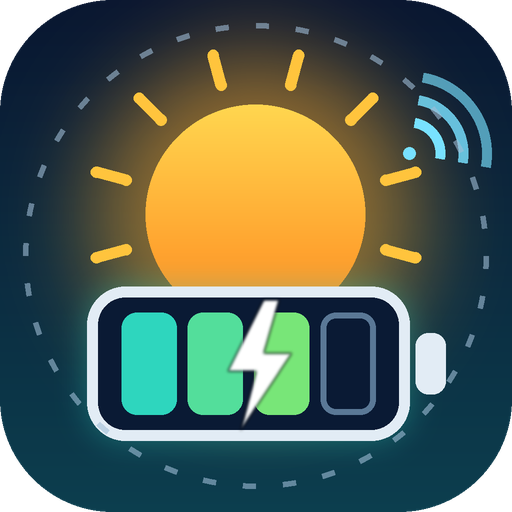

  <a href="README.md">English</a> · <a href="README.de.md">Deutsch</a>

  

<h1 align="center">TSUN Smart (inoffiziell)</h1>

<strong>Home-Assistant-Integration für den TSUN SolarCan DCU2000Lite – über die Cloud der TSUN-Smart-App.</strong>

  
  
  

> [!IMPORTANT]
> **Inoffizielles Community-Projekt. Keine Verbindung zu TSUN / TSUNESS, nicht von TSUN unterstützt oder freigegeben.**
> „TSUN“, „TSUN Smart“ und „SolarCan“ sind Namen ihrer jeweiligen Inhaber und werden hier nur genannt, um zu
> beschreiben, womit die Integration funktioniert. Sie nutzt dieselbe Cloud-Schnittstelle wie die TSUN-Smart-App.
> Diese ist **keine dokumentierte öffentliche API** und kann sich jederzeit ändern oder wegfallen. Nutzung auf eigene Gefahr.

## Warum es das gibt

Der **DCU2000Lite** (DC-gekoppelte Speichereinheit) hat **keine lokale Schnittstelle**: Der WLAN-Logger bietet nur eine
Webseite auf Port 80, Port 8899 ist geschlossen, und die Cloud-Verbindung ist TLS-verschlüsselt. Lokale Projekte wie
[tsun-local](https://github.com/jptstar/tsun-local) und [tsun-gen3-proxy](https://github.com/s-allius/tsun-gen3-proxy)
können ihn deshalb nicht auslesen (siehe [Diskussion #525 bei tsun-gen3-proxy](https://github.com/s-allius/tsun-gen3-proxy/discussions/525)).

Was funktioniert, ist die **Cloud der TSUN-Smart-App** – dieselben Werte wie in der App. Diese Integration liest sie
aus und stellt den Speicherzustand in Home Assistant bereit.

**Gebaut für und getestet an:** TSUN SolarCan **DCU2000Lite**. Alles andere ist ungetestet – siehe
[Mithilfe gesucht](#mithilfe-gesucht-weitere-geräte).

## Was du bekommst

| Entität | Beschreibung |
|---|---|
| Akku-SoC | Ladezustand in % |
| Akkuleistung | W, **positiv = Laden, negativ = Entladen** |
| Verbleibende Energie | kWh, die noch im Akku sind |
| PV-Leistung / PV-Energie heute | aus der Anlagenübersicht |
| Geladen / Entladen heute | kWh |
| PV / Geladen / Entladen gesamt | Lebenszeitzähler in kWh (werden nicht um Mitternacht zurückgesetzt, beste Wahl für das Energie-Dashboard) |
| Akku-Details | Spannung, Strom, Min-/Max-Temperatur, Zustand (SOH), Zellspannungen (min/max), Restkapazität (Ah), Entladetiefe, Arbeitsmodus (z. B. *Konstantleistungsmodus*) |
| PV-Eingänge und Ausgang | PV1-/PV2-Leistung und -Temperatur (Spannung und Strom sind standardmäßig deaktiviert; die PV-Temperaturen sind die der MPPT-Eingänge im Inneren der DCU, nicht die der Module), Ausgangsleistung und -status |
| Signalstufe des Loggers | Diagnose, standardmäßig deaktiviert; die Skala ist unklar (die App zeigt auf der Logger-Seite eine andere Zahl) |
| Hausanschluss *(nur wenn ein Smart Meter an die Cloud meldet; experimentell)* | Verbrauchsleistung, Netzleistung (**+ Bezug / − Einspeisung**), Netzstatus; standardmäßig deaktiviert: Zähler für Bezug / Einspeisung / Verbrauch gesamt, Zählertyp und Leistung je Phase |
| Akku-Status | z. B. `discharge` |
| Cloud-Status, Letzte Cloud-Aktualisierung | Diagnose |
| Online (Binärsensor) | `aus`, solange der Logger offline ist |
| Geräte-Bericht (Konfigurieren-Dialog oder Knopf) | zeigt einen vorausgefüllten GitHub-Issue-Link und einen Mail-Link, siehe [Mithilfe gesucht](#mithilfe-gesucht-weitere-geräte) |

Die Akku- und PV-Details stammen vom selben Bildschirm, den die App unter *Geräte → Batterie → Echtzeit* zeigt; sie werden nur angelegt, wenn dein System sie liefert. Die Sensoren zum Hausanschluss wurden an einem System mit Smart Meter gesehen (ein EcoTracker-kompatibler Zähler an der DCU, dessen Werte der Besitzer verändert), behandle sie also als **experimentell**: Bei Bezug stimmt die Netzleistung mit dem Zähler überein, das Vorzeichen bei Einspeisung ist nicht geprüft, und die drei Zähler waren die Zählerstände des Smart Meters geteilt durch 1000 und mit vertauschtem Bezug/Einspeisung. Sie sind deshalb standardmäßig deaktiviert und für das Energie-Dashboard nicht geeignet. Es sind außerdem Momentwerte, die der Logger alle 5 Minuten hochlädt, keine durchgehenden Messungen.

Die Werte eines Updates können aus leicht unterschiedlichen Zeitpunkten stammen: Die Cloud liefert nicht für jeden Wert einen eigenen Zeitstempel, zusammengehörige Werte (z. B. verbleibende Energie und Restkapazität) passen deshalb kurz mal nicht zusammen.

Systeme mit mehreren Speichern und Geräte, die verschwinden, sind weiter unten unter [Mehrere Speicher in einer Anlage](#mehrere-speicher-in-einer-anlage) beschrieben.

Die Werte kommen etwa **alle 5 Minuten** (so oft meldet der Logger an die Cloud). Häufigeres Abfragen bringt keine neueren
Daten – das Intervall ist zwischen 5 und 60 Minuten einstellbar.

### Verhalten bei „offline“
Der Logger des DCU ist **nachts bzw. bei niedrigem Akkustand offline** (beobachtet bei 20 % SoC). Die Cloud behält dann die
letzten Werte und meldet `ALL_OFFLINE`. Die Integration zeigt diese letzten Werte; am **Online**-Sensor und an
**Letzte Cloud-Aktualisierung** siehst du, wie aktuell sie sind.

### Mehrere Speicher in einer Anlage
*Neu in 0.3.3 bis 0.3.6. Von einem Nutzer mit zwei DCU2000Lite in einer Anlage getestet (0.3.4); bitte melde, wie es bei dir läuft.*

Zum Beispiel zwei DCU2000Lite in einer Anlage der TSUN-Smart-App:
- **Werte der Anlage** (Ladestand, Leistung, geladen/entladen, PV-Zähler) kommen aus der Gesamtsumme der Cloud und umfassen alle Speicher zusammen. Die Restenergie addiert die Packs aller Speicher.
- **Der zuerst gesehene Speicher** ist das Hauptgerät der Anlage („TSUN *Anlagenname*“) und behält seine Entitäten wie bisher. Er bleibt das Hauptgerät, auch wenn die Cloud die Speicher in anderer Reihenfolge liefert.
- **Jeder weitere Speicher** bekommt ein eigenes Gerät („TSUN *Anlagenname* storage 2“, „storage 3“, …) mit eigenem Ladestand, eigener Akkuleistung (positiv = Laden), PV-Leistung, Restenergie, eigenem Akkustatus, PV-Energie und geladener/entladener Energie (heute und gesamt), denselben Detailsensoren (Spannung, Strom, Temperaturen, Zellspannungen, SOH, …), der Signalstufe des Loggers und der Gerätezeit seiner Werte. Wo der Geräte-Bildschirm sie liefert, stammen diese Werte vom Speicher selbst (bei einem System mit einem Speicher sind sie identisch mit den Anlagenwerten). Die Speicher werden an ihrer Cloud-Geräte-ID erkannt, und jeder behält seine Nummer.
- Die Geräte weiterer Speicher sind eigenständig und nicht mit dem Anlagengerät verknüpft (bis 0.3.4 zeigte Home Assistant sie als „verbunden über“ den ersten Speicher, was wie ein Erweiterungsakku aussah).
- Wenn du 0.3.3 mit zwei Speichern in einer Anlage genutzt hast, werden die Entitäten von „storage 2“ in 0.3.4 durch neue ersetzt.
- Die *Gerätezeit der Werte* ist die Ortszeit der Anlage; die Integration nimmt an, dass Home Assistant in derselben Zeitzone läuft.
- Ein Nutzer berichtet, dass die TSUN-App mehrere DCUs in einer Anlage teilweise wie eine Einheit behandelt (zum Beispiel Einstellungen pro Anlage und pro Gerät, bei denen unklar ist, welche gilt). Das ist Verhalten der App; diese Integration liest nur Werte.

### Wenn ein Speicher oder eine Anlage aus der Cloud verschwindet
Nennt die TSUN-Cloud einen Speicher oder eine ganze Anlage nicht mehr (zum Beispiel ein Speicher, der für eine Reparatur aus der Anlage genommen, in eine andere Anlage verschoben oder eine gelöschte Anlage), löscht die Integration nicht sofort:
1. Das Gerät und seine Entitäten werden in Home Assistant **deaktiviert**. Die Historie bleibt.
2. Nennt die Cloud das Gerät wieder, wird es automatisch **wieder aktiviert**, die Integration lädt sich neu, und die Historie läuft weiter.
3. Fehlt ein Gerät **30 Tage** lang, wird es samt Entitäten **entfernt**. (Die aufgezeichnete Historie entfernter Entitäten bleibt in der Datenbank, bis der Recorder sie bereinigt.)
4. Das passiert nur nach einem erfolgreichen Update, das mindestens eine Anlage geliefert hat, ein Aussetzer der Cloud berührt deine Geräte also nicht. Ein veraltetes Gerät kannst du auch von Hand auf seiner Geräteseite löschen.

Fehlt der Hauptspeicher länger als 30 Tage und ist ein anderer Speicher noch da, wird dieser das Hauptgerät der Anlage (seine Werte erscheinen dann am Anlagengerät).

Tipps: Für eine Reparatur ist am einfachsten, den Speicher in der App in der Anlage zu lassen und nur abzuklemmen. Ein Nutzer hat berichtet, dass das Entfernen eines Geräts in der App auch die dort gesammelten Statistiken löscht. Außerdem können sich die Gesamtwerte der Anlage aus der Cloud ändern, wenn ein Speicher fehlt; wie die Cloud sie dann berechnet, ist unbekannt – prüfe also dein Energie-Dashboard, wenn du sie dort nutzt.

### Energie-Dashboard (DC-gekoppelte Systeme)
Der DCU2000Lite ist DC-gekoppelt: Die Module laden den Akku direkt, und der Akku speist deinen Mikro-Wechselrichter (z. B. Hoymiles). Fügst du den Akku ins Energie-Dashboard ein **und** nutzt den AC-Ertrag des Mikro-Wechselrichters als Solarquelle, wird die Akkuentladung doppelt gezählt (sie steckt schon im Ertrag des Wechselrichters).

Vorschlag (eigenes System des Autors, wird noch überprüft):
- **Solar:** *PV-Energie gesamt* dieser Integration (statt des Wechselrichter-Ertrags).
- **Akku:** Energie *aus* dem Akku = *Entladen gesamt*, Energie *in* den Akku = *Geladen gesamt*. Der Sensor für die Akkuleistung ist optional; die Cloud meldet Laden negativ, diese Integration zeigt Laden positiv, wähle also „invertiert“, falls du ihn einträgst.
- Die Cloud-Daten hinken der Echtzeit etwa 3-10 Minuten hinterher, und der DCU selbst zieht offenbar etwa 15 W. Kleine Abweichungen sind normal.
- Berichte bitte deine Erfahrungen in einem Issue.

## Voraussetzungen

- Home Assistant **2025.1** oder neuer
- Ein Konto der **TSUN-Smart-App** (Privatnutzer, Login per E-Mail), in dem dein DCU2000Lite eingerichtet ist.
  Die Weboberfläche des Installateur-/Gewerbeportals (`pro.talent-monitoring.com`) lehnt Privatkonten ab – das ist normal;
  die App-Schnittstelle dahinter akzeptiert sie.

## Installation

### HACS (benutzerdefiniertes Repository)
1. HACS → ⋮ → **Benutzerdefinierte Repositories** → `https://github.com/MarcusStockhaus/ha-tsun-smart-unofficial` als Kategorie **Integration** hinzufügen.
2. **TSUN Smart (inoffiziell)** installieren, Home Assistant neu starten.
3. Einstellungen → Geräte & Dienste → **Integration hinzufügen** → *TSUN Smart (inoffiziell)*.
4. E-Mail und Passwort deines TSUN-Smart-App-Kontos eingeben.

### Manuell
`custom_components/tsun_smart_unofficial` nach `config/custom_components/` kopieren, neu starten, dann ab Schritt 3.

## Datenschutz & Sicherheit

- In Home Assistant wird nur ein **SHA-256-Hash deines Passworts** gespeichert (genau diesen Hash erwartet der Cloud-Login).
  Er ist trotzdem eine Zugangsinformation – schütze deine Home-Assistant-Backups.
- Zugangsdaten und Daten gehen **nur an `pro.talent-monitoring.com`** (TSUNs Cloud), sonst nirgendwohin.
- Der Client sendet denselben `User-Agent` wie die App, weil die Schnittstelle so beobachtet wurde.
- Heruntergeladene Diagnosedaten sind geschwärzt (Seriennummern, Adresse, Koordinaten, Namen, Tokens, Stations- und Geräte-IDs, Einrichtungsdatum) – trotzdem vor dem
  Veröffentlichen kurz durchsehen. Am Anfang steht ein Block `home_assistant` / `custom_components`, den Home Assistant selbst ergänzt (er listet *alle* deine Integrationen): diesen Block vor dem Teilen löschen.

## Nutzungsbedingungen der TSUN-Cloud

Die veröffentlichten [Nutzungsbedingungen](https://pro.talent-monitoring.com/agreement_docs/service_de.html) (Stand 30.09.2023)
enthalten weder ein ausdrückliches Verbot noch eine Erlaubnis für Zugriffe durch Dritte oder automatisierte Abfragen. Sie
verlangen, den ordnungsgemäßen Betrieb des Systems nicht zu stören. Diese Integration fragt nur dein eigenes Konto im
5-Minuten-Takt oder langsamer ab, wie die App. Das ist keine Rechtsberatung; die Bedingungen können sich ändern.

## Mithilfe gesucht: weitere Geräte

Die Cloud-Schnittstelle ist pro **Anlage** aufgebaut und hat allgemeine Felder (PV, Netz, Verbrauch, Akku). Andere TSUN-Produkte
in derselben App *können* daher funktionieren oder leicht ergänzt werden – verifiziert ist aber nur der DCU2000Lite.

So hilfst du, ohne zu programmieren:

1. Integration installieren und unter Einstellungen → Geräte & Dienste → TSUN Smart (inoffiziell) → **Konfigurieren** → **Geräte-Bericht erstellen** öffnen (der Diagnose-Knopf *Geräte-Bericht vorbereiten* macht dasselbe, zeigt aber nur eine Benachrichtigung).
2. In Home Assistant erscheint eine Benachrichtigung mit einem Link. Er öffnet ein **vorausgefülltes GitHub-Issue**, das nur die
   *Struktur* deiner Cloud-Daten enthält (Gerätetypen, Produkt-IDs, welche Felder Daten haben) – **keine Werte,
   Seriennummern, Namen oder Adressen**. Es wird nichts automatisch gesendet; du prüfst und sendest es selbst ab.
3. **Kein GitHub-Konto?** Die Benachrichtigung enthält auch einen E-Mail-Link an den Maintainer und den Berichtstext zum Kopieren.
4. Ergänze, was die App zeigt und hier fehlt. Für mehr Details kannst du zusätzlich die geschwärzte Datei
   *Diagnose herunterladen* anhängen (vorher auf persönliche Daten prüfen und den Block `home_assistant` / `custom_components` am Anfang löschen).

Pull Requests sind willkommen – siehe [CONTRIBUTING.de.md](CONTRIBUTING.de.md).

## Verwandte Projekte

| Projekt | Ansatz | DCU2000Lite |
|---|---|---|
| [tsun-local](https://github.com/jptstar/tsun-local) | lokal TCP 8899, nur lesen | nicht unterstützt (Port zu) |
| [tsun-gen3-proxy](https://github.com/s-allius/tsun-gen3-proxy) | lokaler Proxy → MQTT | nicht unterstützt |
| [ha-talent-monitor](https://github.com/StephanU/ha-talent-monitor) | älteres Cloud-Portal, PV-Sensoren | nicht verifiziert |
| **dieses Projekt** | Cloud-Schnittstelle der TSUN-Smart-App | **ja** |

## Einschränkungen

- Nur lesend. Keine Steuerung des DCU (Modus, Ausgangsleistung).
- Cloud-abhängig; keine Daten, wenn der DCU offline ist; Intervall ≥ 5 Minuten.
- Inoffizielle Schnittstelle: kann ohne Vorwarnung brechen.

## Dokumentation

[API-Notizen](docs/API.de.md) · [Mitmachen](CONTRIBUTING.de.md) · [Änderungsprotokoll](CHANGELOG.md) · [Sicherheit](SECURITY.md)

## Lizenz

[GNU GPL v3.0](LICENSE). Copyright (C) 2026 Marcus Stockhaus. Dieses Programm ist freie Software: Du darfst es nach den Bedingungen der GNU General Public License Version 3 weitergeben und ändern. Es wird ohne jede Gewährleistung verteilt. Abgeleitete Werke müssen unter derselben Lizenz bleiben. Alle Produktnamen gehören ihren Inhabern.
