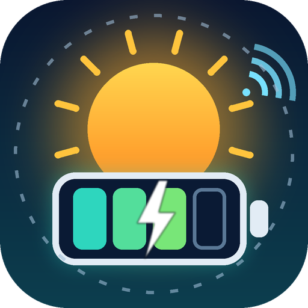

  <a href="README.md">English</a> · <a href="README.de.md">Deutsch</a>

  

<h1 align="center">TSUN Smart (unofficial)</h1>

<strong>Home Assistant integration for the TSUN SolarCan DCU2000Lite — via the cloud of the TSUN Smart app.</strong>

  
  
  

> [!IMPORTANT]
> **Unofficial community project. Not affiliated with, endorsed by or supported by TSUN / TSUNESS.**
> "TSUN", "TSUN Smart" and "SolarCan" are names of their respective owners and are used here only to
> describe what the integration works with. It talks to the same cloud API as the TSUN Smart app, which is
> **not a documented public API** and can change or stop working at any time. Use it at your own risk.

## Why this exists

The **DCU2000Lite** (DC-coupled storage unit) has **no local interface**: its WiFi logger only exposes a web
page on port 80, port 8899 is closed, and the cloud connection is TLS-encrypted. Local projects such as
[tsun-local](https://github.com/jptstar/tsun-local) and [tsun-gen3-proxy](https://github.com/s-allius/tsun-gen3-proxy)
therefore cannot read it (see [tsun-gen3-proxy discussion #525](https://github.com/s-allius/tsun-gen3-proxy/discussions/525)).

What *does* work is the **cloud of the TSUN Smart app** — the same values you see in the app. This integration
reads them and gives you the storage state in Home Assistant.

**Built for and tested on:** TSUN SolarCan **DCU2000Lite**. Everything else is untested — see
[help wanted](#help-wanted-other-devices).

## What you get

| Entity | Description |
|---|---|
| Battery SoC | State of charge in % |
| Battery power | W, **positive = charging, negative = discharging** |
| Remaining energy | kWh left in the pack(s) |
| PV power / PV energy today | from the station summary |
| Charged / discharged today | kWh |
| PV / charged / discharged total | lifetime kWh counters (never reset at midnight; best choice for the Energy dashboard) |
| Battery status | e.g. `discharge` |
| Cloud status, Last cloud update | diagnostics |
| Online (binary sensor) | `off` while the logger is offline |
| Device report (Configure dialog or button) | shows a prefilled GitHub issue link and an e-mail link, see [help wanted](#help-wanted-other-devices) |

Values arrive about **every 5 minutes** (that is how often the logger reports to the cloud).
Polling more often does not give newer data — the interval is configurable between 5 and 60 minutes.

### Offline behaviour
The DCU's logger is **offline at night / when the battery is low** (seen at 20 % SoC). The cloud then keeps the
last known values and reports `ALL_OFFLINE`. The integration shows those last values; use the **Online** sensor
and **Last cloud update** to see how fresh they are.

### Energy dashboard (DC-coupled setups)
The DCU2000Lite is DC-coupled: the panels charge the battery directly, and the battery feeds your micro-inverter (e.g. Hoymiles). If you add the battery to the Energy dashboard **and** use the micro-inverter's AC yield as the solar source, the battery discharge is counted twice (it is already inside the inverter yield).

Suggested setup (author's own system, still being verified):
- **Solar:** *PV energy total* of this integration (instead of the inverter's yield).
- **Battery:** energy going *out of* the battery = *Discharged total*, energy going *into* the battery = *Charged total*. The battery power sensor is optional; the cloud reports charging as negative, this integration shows charging as positive, so choose "inverted" if you add it.
- The cloud data lags real time by roughly 3-10 minutes, and the DCU itself seems to draw about 15 W. Small deviations are normal.
- Please report your experience in an issue.

## Requirements

- Home Assistant **2025.1** or newer
- A **TSUN Smart** app account (private user, e-mail login) that contains your DCU2000Lite.
  The installer/business portal (`pro.talent-monitoring.com` web UI) rejects private accounts — that is expected;
  the app API behind it accepts them.

## Installation

### HACS (custom repository)
1. HACS → ⋮ → **Custom repositories** → add `https://github.com/MarcusStockhaus/ha-tsun-smart-unofficial`, category **Integration**.
2. Install **TSUN Smart (unofficial)**, restart Home Assistant.
3. Settings → Devices & services → **Add integration** → *TSUN Smart (unofficial)*.
4. Enter the e-mail and password of your TSUN Smart app account.

### Manual
Copy `custom_components/tsun_smart_unofficial` into your Home Assistant `config/custom_components/`, restart, then continue with step 3.

## Privacy & security

- Only a **SHA-256 hash of your password** is stored in Home Assistant (the cloud login expects exactly that hash). It is
  still a credential — protect your Home Assistant backups.
- Credentials and data go **only to `pro.talent-monitoring.com`** (TSUN's cloud), nothing else.
- The client sends the same `User-Agent` as the app, because that is what the API was observed with.
- Diagnostics downloads are redacted (serial numbers, address, coordinates, names, tokens, station and device IDs, set-up dates) — still skim them before posting. The file starts with a block `home_assistant` / `custom_components` that Home Assistant itself adds (it lists *all* your integrations): delete that block before you share the file.

## Terms of use of the TSUN cloud

The published [Terms of Service](https://pro.talent-monitoring.com/agreement_docs/service_en.html) (version of 30 Sep 2023)
contain no explicit prohibition or permission for third-party/automated access. They ask users not to interfere with the proper
functioning of the system. This integration polls only your own account every 5 minutes or slower, like the app. This is
not legal advice; the terms may change.

## Help wanted: other devices

The cloud API is organised per **station** with generic fields (PV, grid, load, battery), so other TSUN products
in the same app *may* work or can be added easily — but only the DCU2000Lite has been verified.

You can help without writing code:

1. Install the integration and open Settings → Devices & services → TSUN Smart (unofficial) → **Configure** → **Create device report** (the diagnostic button *Prepare device report* does the same, but only shows a notification).
2. A Home Assistant notification appears with a link. It opens a **prefilled GitHub issue** that contains only the
   *structure* of your cloud data (device types, product IDs, which fields have data) — **no values, serial numbers,
   names or addresses**. Nothing is sent automatically; you review and submit it yourself.
3. **No GitHub account?** The notification also contains an e-mail link to the maintainer and the report text to copy.
4. Add what the app shows that is missing here. For more detail you can also attach the redacted
   *Download diagnostics* file (check it for personal data first and delete the `home_assistant` / `custom_components` block at the top).

Pull requests are welcome — see [CONTRIBUTING.md](CONTRIBUTING.md).

## Related projects

| Project | Approach | DCU2000Lite |
|---|---|---|
| [tsun-local](https://github.com/jptstar/tsun-local) | local TCP 8899, read-only | not supported (port closed) |
| [tsun-gen3-proxy](https://github.com/s-allius/tsun-gen3-proxy) | local proxy → MQTT | not supported |
| [ha-talent-monitor](https://github.com/StephanU/ha-talent-monitor) | older cloud portal, PV sensors | not verified |
| **this project** | TSUN Smart app cloud API | **yes** |

## Limitations

- Read-only. No control of the DCU (mode, output power).
- Cloud dependent; no data when the DCU is offline; update interval ≥ 5 minutes.
- Unofficial API: can break without notice.

## Documentation

[API notes](docs/API.md) · [Contributing](CONTRIBUTING.md) · [Changelog](CHANGELOG.md) · [Security](SECURITY.md)

## License

[GNU GPL v3.0](LICENSE). Copyright (C) 2026 Marcus Stockhaus. This program is free software: you can redistribute it and/or modify it under the terms of the GNU General Public License version 3. It is distributed without any warranty. Derived works must stay under the same license. All product names belong to their owners.
